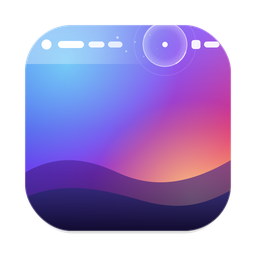

<p align="center">
  
</p>

<h1 align="center">MenuBarClear</h1>

<p align="center">
  <b>Remove the menu bar background on macOS.</b><br>
  Your menus and status icons float directly on the wallpaper.
</p>

<p align="center">
  
  
  
</p>

---

## Features

- **No menu bar background.** The blur and tint are gone; your wallpaper shows through edge to edge.
- **Follows your wallpaper live.** It updates the instant you change wallpapers, cross-fade included.
- **Readable on any wallpaper.** Menus turn black on bright wallpapers and white on dark ones. Status icons are recoloured to match whenever macOS gets it wrong; coloured icons keep their colours.
- **Liquid-glass ripple** at the exact spot of every menu bar click.
- **Instant app switching.** Menus are cached per app, and the old menus never disappear before the new ones are ready.
- **Plays nicely with the system.** Clicks go straight to the real menus, and it handles multiple displays, Spaces, full-screen apps and lock/unlock.
- **Lightweight.** It's a native Swift app with no dependencies. Animations run on the GPU through Core Animation.

## Requirements

- macOS 14 Sonoma or later. It is developed and tested on **macOS 15 Sequoia** (Apple silicon).
- Two privacy permissions:
  - **Screen & System Audio Recording**, to see the wallpaper pixels behind the bar.
  - **Accessibility**, to read menu positions and notice menu bar clicks.

MenuBarClear never records, stores or sends anything. It only reads the small strip of wallpaper behind the menu bar.

## Install

### Download

1. Download **`MenuBarClear-x.y.z.dmg`** from [Releases](../../releases).
2. Open it and drag **MenuBarClear** onto **Applications**.
3. The app isn't notarized yet, so the first time, right-click MenuBarClear in Applications and choose **Open**, then **Open** again. Or run:
   ```sh
   xattr -dr com.apple.quarantine /Applications/MenuBarClear.app
   ```
4. Allow both permissions when asked, then choose **Restart** from the MenuBarClear menu bar icon.

### Build from source

```sh
xcode-select --install          # Command Line Tools, if you don't have Xcode
git clone https://github.com/aafs-ops/MenuBarClear.git
cd MenuBarClear
make install                    # builds, installs into /Applications and launches
```

| Command | What it does |
| --- | --- |
| `make app` | Builds `build/MenuBarClear.app` |
| `make app ARCHS="arm64 x86_64"` | Builds a universal app |
| `make run` | Builds and launches from `build/` |
| `make install` | Builds and installs into `/Applications` |
| `make dmg` | Builds the drag-to-install disk image |
| `make zip` | Builds a plain zip of the app |
| `make uninstall` | Removes the app, its settings and its permissions |

> **Note:** every local build is ad-hoc signed, so macOS treats each rebuild as a new app. After rebuilding, remove the old MenuBarClear entries under System Settings → Privacy & Security → *Screen & System Audio Recording* and *Accessibility* (–), then allow it again.

## Usage

Click the MenuBarClear icon in the menu bar (left or right click):

| Item | |
| --- | --- |
| **Clear Menu Bar** | Pause or resume the effect |
| **Launch at Login** | Start MenuBarClear automatically |
| **Hide Menu Bar Icon** | Remove the icon; MenuBarClear keeps running |
| **About MenuBarClear** | Version and credits |
| **Restart** | Relaunch, e.g. after granting permissions |
| **Quit MenuBarClear** | ⌘Q |

### Getting the icon back

Open MenuBarClear again from **Applications**, **Spotlight** or **Launchpad** while it's running, and the icon reappears. You can also run:

```sh
open -a MenuBarClear
```

## How it works

On macOS 15 the menu bar is made of:

- one WindowServer-owned window named `Menubar`, which draws the bar background **and** the frontmost app's menus, and
- one small window per status item (the icons on the right), on the layer above.

MenuBarClear places a click-through panel on each display's menu bar:

1. **Stacking.** The panel goes on the `Menubar` window's layer with WindowServer sub-level 1. That puts it above the background and below every status item. AppKit can't order windows relative to other processes' windows, but WindowServer honours a sub-level set by the window's owner.
2. **Wallpaper.** ScreenCaptureKit captures only the desktop-picture windows behind the bar, so no app windows and no menus, and paints that strip on the panel. The capture refreshes when the wallpaper store changes and every 2 s as a safety net.
3. **Menus.** Because the panel covers the `Menubar` window, the Apple menu, app name and menu titles are redrawn at the exact positions reported by the Accessibility API. Clicks fall through to the real menus.
4. **Status-item tint.** macOS chooses black or white status icons based on its own idea of the bar. When that doesn't match the wallpaper, the panel moves in front of the status items and shows a live, recoloured ScreenCaptureKit copy of them.
5. **Ripples.** A global event monitor observes, but never intercepts, menu bar clicks and animates a Core Animation lens at the click point.

## Troubleshooting

**Nothing changes.** Make sure both permissions are on, then choose **Restart** from the MenuBarClear menu. Screen Recording only takes effect after a restart.

**Something looks misplaced.** Open an issue with your macOS version, Mac model, a screenshot and the output of:
```sh
/Applications/MenuBarClear.app/Contents/MacOS/MenuBarClear --list
```

**`xcrun: error: unable to load libxcrun`** while building means the selected Xcode doesn't match your macOS. The build script falls back to the Command Line Tools automatically. If it still fails, run `sudo xcode-select --switch /Library/Developer/CommandLineTools`.

## Uninstall

```sh
make uninstall
```
or quit MenuBarClear and delete `/Applications/MenuBarClear.app`.

## Limitations

- MenuBarClear relies on how macOS 15 composes the menu bar and on one private WindowServer call (`SLSSetWindowSubLevel`). A future macOS update could change either.
- Menus are redrawn with the system menu bar font; very custom menu titles (e.g. icon-only menus in some apps) appear as text.
- macOS 26 Tahoe and later have a built-in *Show menu bar background* switch.

## Contributing

Issues and pull requests are welcome. See [CONTRIBUTING.md](CONTRIBUTING.md).

## License

[MIT](LICENSE) © 2026 aafs-ops
